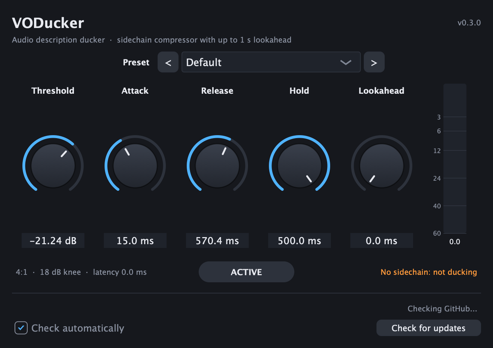

# VODucker

A sidechain ducking compressor for **audio description (AD) post-production**. It is available as a VST3 on all platforms, plus an AU on macOS.



In an AD mix, the describer's narration has to sit clearly on top of the programme audio
(dialogue, music and effects) without the programme jumping up and down around it.
VODucker goes on the programme audio and is keyed by the AD narration track. It turns the
programme down while the describer speaks and brings it back when they stop.

Its main feature is a **lookahead of up to 1 second**. Most ducking compressors look ahead
only a few milliseconds, so the first word of each description lands on full-level programme
audio and the duck catches up afterwards. VODucker starts lowering the programme *before*
the describer's first word, so every description starts clear. It keeps the programme down
until the last word has finished.

## Controls

| Control   | Range            | Default  | What it does in an AD mix |
|-----------|------------------|----------|---------------------------|
| Threshold | -60 to 0 dB      | -21.24 dB | How loud the narration has to be before the programme ducks (centre of the knee). Lower = more ducking |
| Attack    | 1 to 250 ms      | 15 ms    | How fast the programme goes down once a description starts |
| Release   | 1 ms to 5 s      | 570.4 ms | How fast the programme comes back up after a description ends |
| Hold      | 0 to 500 ms      | 500 ms   | Keeps the programme down through short pauses between phrases, so it doesn't bob up mid-description |
| Lookahead | 0 to 1000 ms     | 0 ms     | How far ahead of the describer's first word the duck begins (adds the same amount of latency) |
| Bypass    | On / off         | Off      | Turns the ducking off with a short 20 ms fade (no click). The Lookahead delay stays, so timing doesn't shift. Automatable |

Fixed character: **4:1 ratio**, **18 dB soft knee**, peak detection (stereo-linked),
gain reduction up to **60 dB**. There is **no makeup gain and no auto-gain**. The plugin only
ever turns the programme down, so the programme level between descriptions is exactly what
it was before VODucker.

**Bypass** is VODucker's own internal switch, separate from your DAW's plugin bypass. It
doesn't change or follow the DAW's bypass state. It's a normal plugin parameter, so you can
write automation for it, for example to switch the ducking off for a stretch of the programme
where you don't want it, and the button in the plugin window follows along.

## Presets

Pick a starting point from the **Preset** menu (or step through with **<** / **>**). Your DAW
also lists them as the plugin's factory presets. A preset sets the timing (Attack,
Release, Hold and Lookahead). It leaves **Threshold** and **Bypass** alone: Threshold depends on
how loud your narration is, so set it for your session and it stays put when you switch
presets. Once you move one of the preset's knobs, the menu shows the preset name with
*(edited)*, and your DAW session saves your settings as usual.

| Preset | Attack | Release | Hold | Lookahead | Use it for |
|--------|--------|---------|------|-----------|------------|
| Default | 15 ms | 570.4 ms | 500 ms | 0 ms | The plugin's defaults, no latency |
| AD Natural | 30 ms | 800 ms | 500 ms | 150 ms | General AD work: a smooth dip that's down by the first word |
| AD Early Duck | 60 ms | 700 ms | 500 ms | 400 ms | Gentle, long fades that start well before the describer speaks |
| AD Tight | 5 ms | 250 ms | 200 ms | 50 ms | Short descriptions in busy scenes; the programme recovers quickly |
| Slow Recovery | 20 ms | 1.2 s | 500 ms | 250 ms | The programme swells back slowly after each description; suits music beds |
| Zero Latency | 3 ms | 500 ms | 500 ms | 0 ms | Live or monitoring use where you can't add latency |

## How the lookahead works

The programme audio is delayed by the lookahead time, while the narration (sidechain) is
analysed straight away. The plugin reports that delay to your DAW as latency, so with plugin
delay compensation on, everything stays in sync with picture and the duck starts
*Lookahead* ms before the describer speaks.

Delaying the audio alone would make the duck *end* early too (the programme would come back
up before the describer finished). VODucker holds the gain reduction for the whole lookahead
window, so the release only starts once the description has really ended (plus any *Hold* time).

Changing Lookahead changes the plugin's latency. Most DAWs handle this live; some only
pick it up when playback stops and starts again. Offline bounces and exports are always
compensated.

## Using it in an AD session

1. Put VODucker on the programme audio: the full mix, the stems bus, or each stem you want
   ducked (for example, music and effects but not dialogue).
2. Send the AD narration track to VODucker's **sidechain input**. How you do this depends on your DAW.
3. Play a description. Lower **Threshold** until the meter shows the amount of ducking you want
   while the describer speaks.
4. Set **Lookahead** so the programme has finished dipping by the first word, then adjust
   **Attack**, **Hold** and **Release** to taste.

The defaults are a good starting point for AD work. Lookahead starts at 0 so the plugin adds
no latency until you ask for it. Always check the result against your client's or
broadcaster's AD mix specs.

The status line to the right of the Bypass switch shows whether a sidechain is connected. **Until a sidechain is connected, VODucker
does nothing to the track**: the programme passes through untouched, just delayed by the
Lookahead time so its timing doesn't jump when you connect the narration later. If your DAW
always exposes the sidechain input, an unrouted sidechain is silent, so the result is the same.

## Install

Download the zip for your system from the
[latest release](https://github.com/kyle95wm/VO-Ducker/releases/latest), extract it, and run
the included installer, or copy the plugin yourself:

| OS      | Installer             | Manual location |
|---------|-----------------------|-----------------|
| macOS   | `./install.sh`        | `VODucker.vst3` → `~/Library/Audio/Plug-Ins/VST3`, `VODucker.component` → `~/Library/Audio/Plug-Ins/Components` |
| Windows | `install.ps1` (right-click → Run with PowerShell) | `VODucker.vst3` → `C:\Program Files\Common Files\VST3` |
| Linux   | `./install.sh`        | `VODucker.vst3` → `~/.vst3` |

One-line install of the latest release:

```bash
curl -fsSL https://raw.githubusercontent.com/kyle95wm/VO-Ducker/main/scripts/install.sh | bash
```

```powershell
# Windows, from an Administrator PowerShell
irm https://raw.githubusercontent.com/kyle95wm/VO-Ducker/main/scripts/install.ps1 | iex
```

**macOS note:** the builds are ad-hoc signed but not notarised. `install.sh` removes the
quarantine flag for you. If you copy the plugin by hand and macOS blocks it, run
`xattr -dr com.apple.quarantine ~/Library/Audio/Plug-Ins/VST3/VODucker.vst3`.

## Updates

The plugin window checks this repo's GitHub Releases (at most once a day) and shows
**Update available** with a Download button when there's a newer version. You can turn off
automatic checks with the *Check automatically* box, or check by hand with *Check for updates*.
The check is a single anonymous request to `api.github.com`. Nothing else is sent.

## Building from source

You need CMake 3.22+, a C++17 compiler, and Git. JUCE is downloaded automatically.

```bash
cmake -S . -B build -DCMAKE_BUILD_TYPE=Release
cmake --build build --config Release --parallel
ctest --test-dir build -C Release --output-on-failure
```

The plugins end up in `build/VODucker_artefacts/Release/`.

- **macOS:** Xcode or the Command Line Tools. Add `-DCMAKE_OSX_ARCHITECTURES="arm64;x86_64"` for a universal build.
- **Windows:** Visual Studio 2022 or newer with the C++ workload.
- **Linux (Debian/Ubuntu):**
  ```bash
  sudo apt install build-essential cmake git libasound2-dev libjack-jackd2-dev libcurl4-openssl-dev \
    libfreetype-dev libfontconfig1-dev libx11-dev libxcomposite-dev libxcursor-dev libxext-dev \
    libxinerama-dev libxrandr-dev libxrender-dev libglu1-mesa-dev mesa-common-dev
  ```

Options: `-DVO_DUCKER_BUILD_AU=OFF`, `-DVO_DUCKER_BUILD_STANDALONE=ON`, `-DVO_DUCKER_COPY_AFTER_BUILD=ON`
(installs into your user plug-in folders after building), `-DVO_DUCKER_JUCE_PATH=/path/to/JUCE`.

To refresh the README screenshot after changing the UI, build with
`-DVO_DUCKER_BUILD_SCREENSHOT_TOOL=ON` and run
`./build/VODuckerScreenshot_artefacts/Release/VODuckerScreenshot docs/screenshot.png`.

## Releasing

1. Push a tag: `git tag v1.0.0 && git push origin v1.0.0`
2. GitHub Actions builds Windows, macOS (universal) and Linux, runs the tests, and publishes a
   Release with the zips and install scripts. The version inside the plugin comes from the
   tag, so the update checker always compares against the right number.

## License

AGPL-3.0, as required by JUCE's open-source license. VST is a trademark of Steinberg Media Technologies GmbH.
